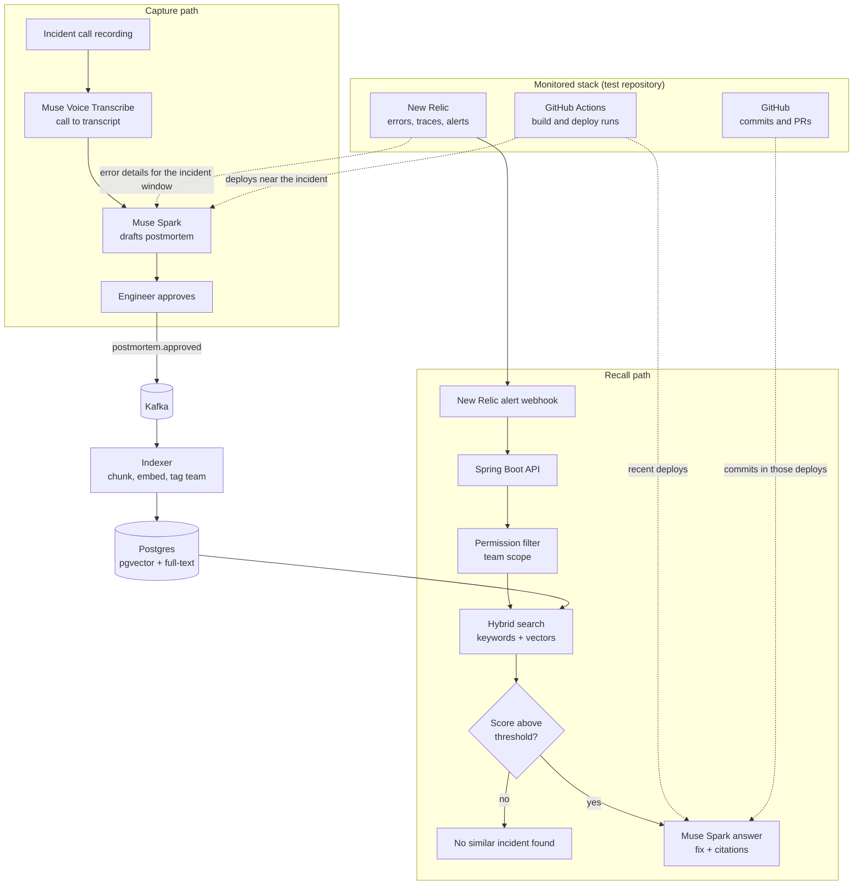

# Incident Memory

**AI that remembers how your team fixed things.**

Built for the Meta Global AI Developer Hackathon, Indie developer track, theme *Build for Your World*.

---

## The problem

During an incident, the real fix is worked out on a call: who checked what, what failed, and what finally worked. When the call ends, that knowledge disappears, because nobody has time to write it down. The next time the same error fires, someone else spends an hour rediscovering the fix.

Plain "chat with your docs" tools do not solve this. They:

- miss exact error codes such as `ERR_PAYMENT_409`, because vector search matches meaning, not exact strings
- quote stale runbooks for services that have since changed
- can answer from documents the asking team should not see
- invent an answer when nothing relevant exists

## The solution

Incident Memory has two paths.

1. **Capture.** A recorded incident call is transcribed, Muse Spark drafts a structured postmortem (cause, fix, owner, related deploy), and an engineer approves it with one click. Approved postmortems become searchable memory through a Kafka event.
2. **Recall.** When New Relic fires the same alert again, Incident Memory finds the past incident with hybrid search, checks the recent GitHub Actions deploys and commits, and answers in seconds with the fix and citations. If nothing matches well, it says *"No similar incident found"* instead of guessing.

A human approves every postmortem before it becomes memory, so an AI mistake never becomes team knowledge.

---

## Architecture



### Components

| Component | Responsibility |
|---|---|
| **Spring Boot API** | Receives New Relic alert webhooks and user questions, runs the recall path, serves the UI. |
| **Capture service** | Uploads call recordings, calls Muse Voice Transcribe, asks Muse Spark for a structured postmortem, stores drafts for approval. |
| **Kafka** | Carries `postmortem.approved` and `document.changed` events, so indexing never blocks the user and only changed content is re-indexed. |
| **Indexer** | Kafka consumer that chunks a postmortem or runbook, creates embeddings, and writes chunks with their team tag. |
| **Postgres + pgvector** | One database for vector search (pgvector) and keyword search (full-text `tsvector`). |
| **Context fetchers** | Read-only clients for New Relic (errors, traces), GitHub Actions (workflow runs), and GitHub (commits). |
| **React UI** | Approve-postmortem screen where the engineer can edit fields and click Approve or Reject (only approved postmortems move on to indexing), and an alert answer screen that shows the alert, the answer, and clickable sources, plus a team switcher for the permissions demo. |

### Recall in five steps

1. **Alert arrives.** New Relic sends a webhook, for example `ERR_PAYMENT_409` on `payment-service`.
2. **Permission filter.** The search is restricted to documents the alert's team may see, *before* retrieval runs.
3. **Hybrid search.** Keyword search catches the exact error code, vector search catches incidents described in different words, and the two result lists are merged.
4. **Score check.** If the best match is below the threshold, the API returns "No similar incident found".
5. **Answer.** Muse Spark reads the full matching postmortems plus recent GitHub Actions deploys and commits, and returns the likely fix with links to each source.

### Kafka topics

| Topic | Key | Produced when | Consumed by |
|---|---|---|---|
| `postmortem.approved` | `incidentId` | An engineer approves a draft | Indexer |
| `document.changed` | `documentId` | A runbook section is edited | Indexer (re-indexes only the changed section) |

### Data model (simplified)

```sql
incidents (
  id            uuid primary key,
  team_id       text not null,
  title         text,
  error_codes   text[],
  postmortem    text,
  status        text,          -- draft | approved
  call_url      text,
  created_at    timestamptz
)

chunks (
  id            uuid primary key,
  source_id     uuid,          -- incident or runbook id
  team_id       text not null, -- used by the permission filter
  section       text,
  content       text,
  content_tsv   tsvector,      -- keyword search
  embedding     vector(768),   -- vector search
  updated_at    timestamptz
)
```

---

## Meta models used

| Model | Used for |
|---|---|
| **Muse Voice Transcribe** | Turns incident call recordings into transcripts. |
| **Muse Spark** | Drafts structured postmortems and writes cited answers. Its 1M-token context lets it read whole past postmortems instead of small snippets. |
| **Muse Code** | Used as a coding agent while building the project. |

Model IDs and the base URL are set through environment variables, so they can be changed without code edits.

---

## Tech stack

- **Backend:** Java, Spring Boot, Gradle
- **Frontend:** React / Next.js, TypeScript
- **Messaging:** Kafka (single broker in Docker Compose)
- **Storage:** PostgreSQL with pgvector
- **Embeddings:** local model through Ollama
- **Integrations:** New Relic, GitHub, GitHub Actions
- **CI:** GitHub Actions

---

## Repository layout

```
incident-memory/
├── backend/            Spring Boot API, capture service, indexer
├── frontend/           React UI
├── demo-data/          synthetic incidents, runbooks, mock call recordings
├── evals/              test alerts and expected matches
├── docker-compose.yml  Postgres + pgvector, Kafka
└── .github/workflows/  CI
```

---

## Getting started

### Prerequisites

- Java 21, Node 20, Docker, Ollama
- A Meta Model API key
- A New Relic account (free tier works) and a user API key
- A GitHub personal access token with read access to the test repository

### Environment variables

```bash
META_API_BASE_URL=https://api.meta.ai/v1
MODEL_API_KEY=...
META_CHAT_MODEL=muse-spark-...
META_TRANSCRIBE_MODEL=muse-voice-transcribe-...

NEW_RELIC_API_KEY=...
NEW_RELIC_ACCOUNT_ID=...

GITHUB_TOKEN=...
GITHUB_REPO=owner/test-repo

EMBEDDING_MODEL=nomic-embed-text
NO_MATCH_THRESHOLD=0.55
```

### Run

```bash
docker compose up -d          # Postgres + pgvector, Kafka
cd backend && ./gradlew bootRun
cd frontend && npm install && npm run dev
```

---

## Evaluation

| Metric | How it is measured |
|---|---|
| **Hit rate @3** | For 30 test alerts with a known past incident, how often the correct incident appears in the top 3 results. |
| **Honest misses** | For 10 alerts with no matching incident, how often the system correctly answers "No similar incident found". |
| **Capture time** | Time from the end of a call recording to a searchable, approved postmortem. |
| **Answer latency** | p50 and p95 time from alert to answer. |

All evaluation data is synthetic. No real company incidents, logs, or recordings are used.

### Latest results

Run with `python ai-service/scripts/eval.py` against the bundled synthetic set (30 alerts with a known incident, 10 with none):

| Metric | Result |
|---|---|
| Hit rate @3 | 90.0% |
| Honest misses | 90.0% |
| Answer latency p50 | 724 ms |
| Answer latency p95 | 1499 ms |

---

## Roadmap

- **Signal Hub:** a monitoring marketplace where each team plugs in its own tool (Datadog, Grafana, Splunk, and others) through MCP connectors that share one interface.
- **Hedged model calls:** race Muse Spark against Muse Spark Open when the first response is slow, to cut tail latency.
- **Runbook sync:** re-index runbooks directly from GitHub when they change.
